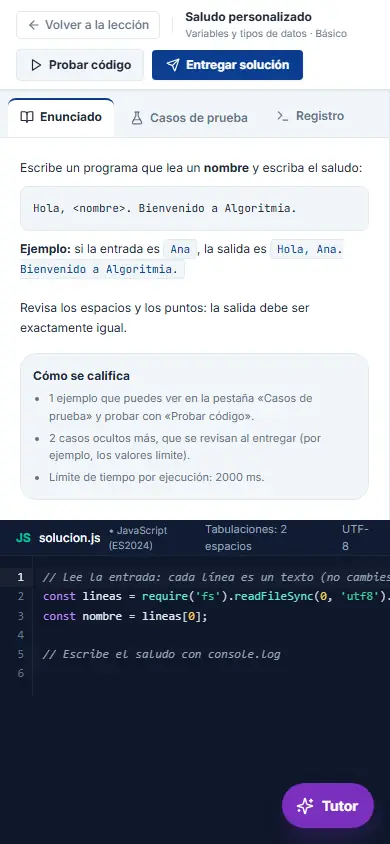
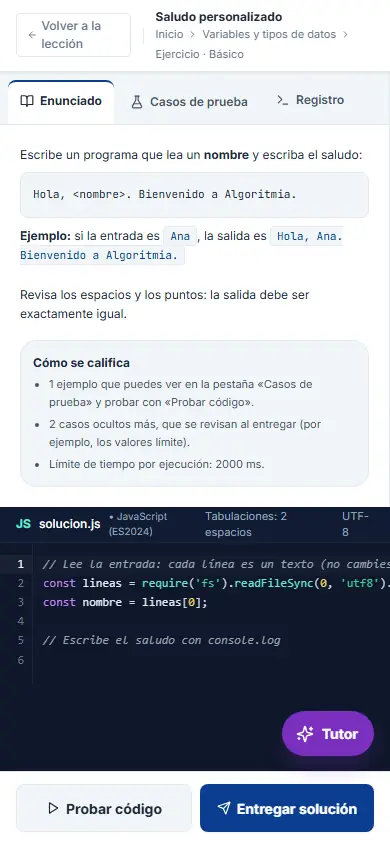
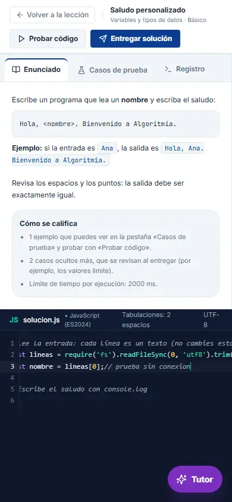
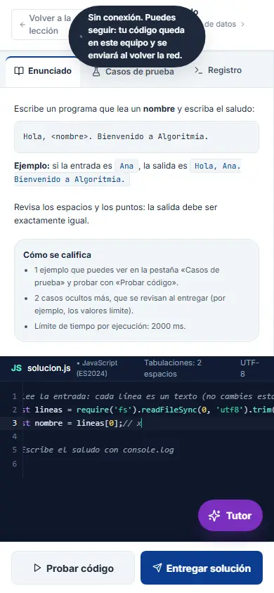
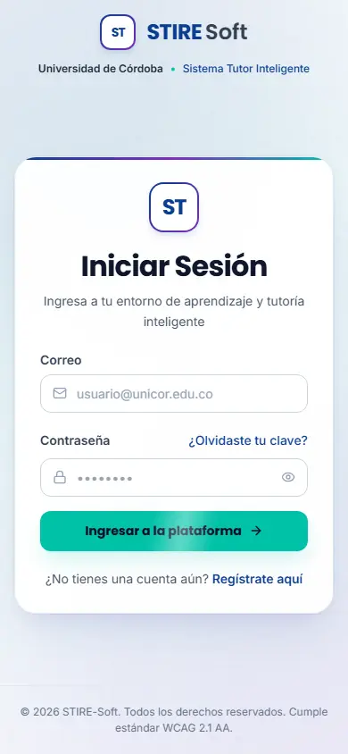
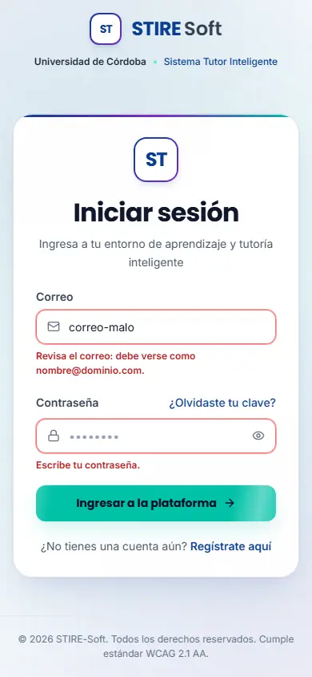
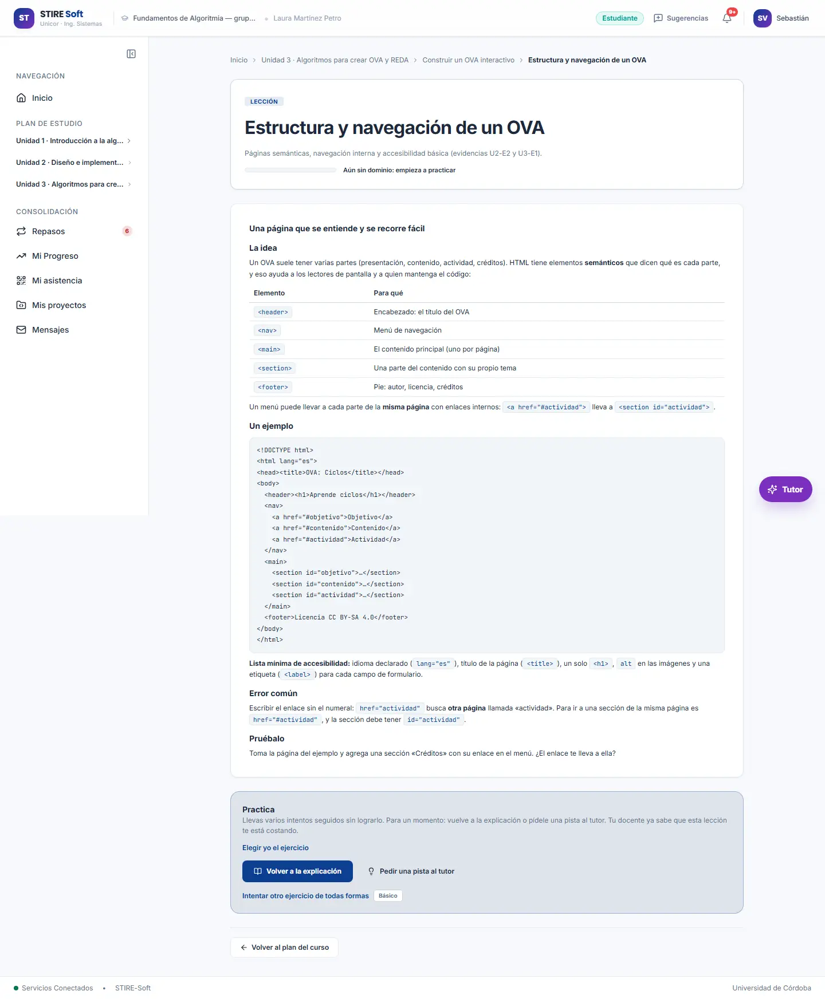
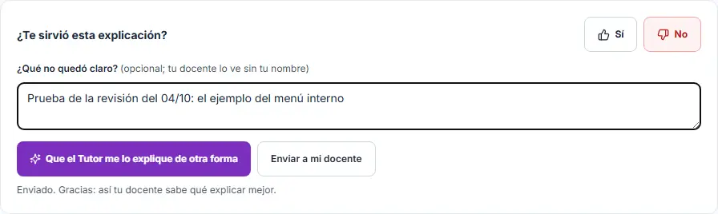

# Cómo estaba STIRE antes de las listas de chequeo

El «antes» es la versión que estaba publicada el **sábado 04/10/2026**, cuando se aplicaron por primera vez las dos
listas del profesor. Todo lo que se compara (notas, capturas y el pitch) parte de esa versión.

## 1. De dónde sale la primera versión

| | Antes de las listas | Hoy |
|---|---|---|
| Versión | v1.1.0 con los ajustes de UI/UX del 02 y 03/10 | v2.0.0 candidata, con las correcciones de la prueba de dos semanas |
| Commit | [`7c9977b`](https://github.com/Jeider-Gomez/Stire-Soft/tree/7c9977b1a272a22e88a1085b3b2354946b75ee51) (03/10/2026, 11:33 p. m.) | `main` |
| Enlace | https://stire-soft-b6ep923aj-lic-jeider.vercel.app | https://stire-soft.vercel.app |
| Nota (evaluación del 04/10) | Interfaz 20 / 32 · 62,5 % · Tutores Inteligentes 14 / 24 · 58,3 % | Ver [`CRITERIOS_Y_RESULTADOS.md`](CRITERIOS_Y_RESULTADOS.md) |

**El enlace de la versión anterior.** Vercel guarda cada versión publicada con su propia dirección. La del 04/10 sigue
ahí, pero Vercel la protege: hoy solo la abre quien tiene sesión en la cuenta de Vercel del proyecto (Jeider). Para
mostrarla en el pitch o pasarla al profesor hay dos caminos, los dos sin costo:

1. **Enlace para compartir** (recomendado): en Vercel, abrir esa versión y usar «Share» para copiar un enlace de
   acceso. Abre solo esa versión.
2. Quitar la protección de las versiones anteriores (Settings → Deployment Protection → Vercel Authentication). Abre
   todas las versiones viejas, así que es menos recomendable.

**Ojo:** la versión vieja usa el servidor de hoy. Lo que existía el 04/10 debería funcionar, porque el servidor solo
agregó cosas, pero no se ha probado entera. Para el pitch, lo seguro son las capturas del 04/10 (abajo).

## 2. Cómo estaba, criterio por criterio

Lo que faltaba el 04/10, según la evaluación de ese día
([interfaz](../2026-10-04_antes/CHECKLIST_INTERFAZ_2026-10-04.md) y
[Tutores Inteligentes](../2026-10-04_antes/CHECKLIST_ITS_2026-10-04.md)).

### Interfaz

| ID | Nota | Lo que faltaba el 04/10 |
|---|---|---|
| UX-01 | C | El ejercicio no tenía migas; el resto del curso sí. |
| UX-02 | CP | 4 confirmaciones usaban la ventana del navegador; el autoguardado fallaba sin reintentar. |
| UX-03 | C | — |
| UX-04 | CP | 93 emojis en 25 pantallas mezclados con íconos; títulos con mayúsculas distintas; «Volver al Dashboard». |
| UX-05 | CP | No había Personas ni análisis de tareas escritos. |
| UX-06 | CP | Un F5 borraba el código; «Probar» y «Entregar» medían 30 a 32 px. |
| UX-07 | CP | Contraste insuficiente en 5 a 24 elementos por pantalla; 2 campos sin etiqueta; sin «Saltar al contenido». |
| UX-08 | CP | Sin SUS ni prueba con usuarios. |
| MOB-01 | C | — |
| MOB-02 | CP | En el celular, «Probar» y «Entregar» estaban arriba y eran pequeños; 24 de 29 controles del inicio medían menos de 44 px. |
| MOB-03 | CP | Sin modo oscuro; el código de clase no pedía mayúsculas. |
| MOB-04 | CP | Sin red solo decía «No se pudo autoguardar». |
| PAT-01 | CP | 31 de 40 páginas llamaban a la API desde la vista. |
| PAT-02 | C | El ejercicio no tenía migas. |
| PAT-03 | CP | El inicio de sesión usaba el globo del navegador; el código de clase aceptaba cualquier formato. |
| PAT-04 | CP | 27 de 95 componentes pasaban de 300 líneas (el mayor, 1532). |

### Tutores Inteligentes

| ID | Nota | Lo que faltaba el 04/10 |
|---|---|---|
| MOD-01 | CP | Todas las lecciones abiertas: no se veían los prerrequisitos. |
| MOD-02 | CP | Sin diagnóstico de errores de concepto; la racha no coincidía entre pantallas. |
| MOD-03 | C | — |
| MOD-04 | C | El mensaje del evaluador era frío («se esperaba 8 y se mostró 53»). |
| UI-01 | NC | La lección no se podía ver como diagrama o paso a paso. |
| UI-02 | CP | — |
| UI-03 | C | — |
| UI-04 | NC | No se podía valorar una lección ni pedir otra explicación. |
| UI-05 | C | — |
| META-01 | CP | «Mi progreso» daba números, sin invitar a pensar en cómo se estudia. |
| META-02 | NC | No preguntaba qué tan seguro estaba el estudiante. |
| META-03 | C | Faltaba un «¿Por qué veo esto?» en el inicio. |

## 3. Capturas: antes y hoy

Las del 04/10 están en [`../2026-10-04_antes/capturas/`](../2026-10-04_antes/capturas/) y las de después en
[`../2026-10-04_despues/capturas/`](../2026-10-04_despues/capturas/), con los mismos nombres: `pc_` computador, `cel_`
celular, `est` estudiante y `doc` docente. Algunas parejas útiles para el pitch:

| Criterio | Antes (04/10) | Después |
|---|---|---|
| MOB-02 · botones del ejercicio en el celular |  |  |
| MOB-04 · sin conexión |  |  |
| PAT-03 · inicio de sesión |  |  |
| UI-04 · ¿te sirvió? |  |  |

Para lo corregido después de la revisión del equipo (UX-02, MOB-01, MOB-02, UI-04 del 12 al 17/10), la captura de
«después» se toma de https://stire-soft.vercel.app.
